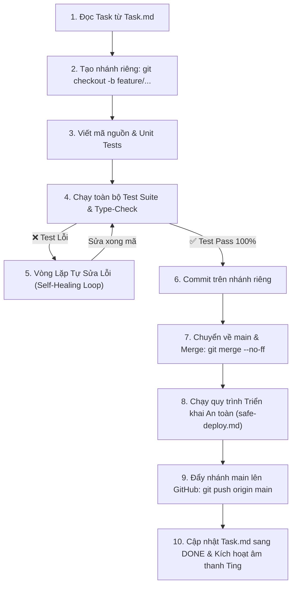

# Workflow: Quy Trình Vận Hành Task Chuẩn Mực (Task Lifecycle Workflow)

Quy trình bắt buộc áp dụng cho mọi nhiệm vụ phát triển tính năng hoặc sửa lỗi trong dự án **ShopFlow**, đảm bảo nhánh `main` luôn ở trạng thái ổn định (Production-Ready) và mã nguồn được kiểm thử 100% trước khi triển khai.

---

## 🔄 Sơ Đồ Quy Trình Tự Động (Process Flowchart)



---

## 📋 Chi Tiết Các Bước Thực Hiện

### Bước 1: Khởi Tạo Nhánh Làm Việc Riêng (Feature Branch)
> [!IMPORTANT]
> **Tuyệt đối không viết code trực tiếp trên nhánh `main`.** Mọi công việc đều phải được cô lập trên một nhánh riêng biệt.

1. Đảm bảo nhánh `main` ở trạng thái mới nhất và sạch sẽ:
   ```bash
   git checkout main
   git pull origin main
   ```
2. Khởi tạo và chuyển sang nhánh riêng theo quy ước đặt tên:
   - Tính năng mới: `feature/<task-id>-<ten-ngan-gon>` (Ví dụ: `feature/task-02-docker-compose`)
   - Sửa lỗi: `fix/<task-id>-<ten-ngan-gon>` (Ví dụ: `fix/webhook-hmac-timing-attack`)
   ```bash
   git checkout -b feature/<task-id>-<ten-task>
   ```
3. Cập nhật tệp [Task.md](file:///c:/Users/Dell/Desktop/ShopFlow/Task.md): Chuyển task sang mục `### 📋 TRẠNG THÁI: IN PROGRESS (ĐANG THỰC HIỆN)`.

---

### Bước 2: Phát Triển & Kiểm Thử Toàn Diện (Development & Testing)
1. Tiến hành viết mã nguồn, tuân thủ:
   - Clean Architecture (`api/`, `core/`, `infrastructure/`, `config/`, `utils/`).
   - TypeScript Strict Mode (`noImplicitAny`, strict null checks).
   - Bảo mật: Không hardcode secret, sử dụng Zod schema để kiểm tra biến môi trường.
2. Viết unit tests và integration tests tương ứng cho tính năng mới.
3. Chạy kiểm tra tĩnh và toàn bộ bài test:
   ```bash
   npm run type-check --workspaces
   npm test --workspaces --if-present
   ```

---

### Bước 3: Vòng Lặp Tự Động Phân Tích & Sửa Lỗi (Self-Healing Loop)
Nếu bài kiểm tra hoặc lệnh type-check báo lỗi (**Test Failed / Compilation Error**):
1. **Phân tích lỗi (Root Cause Analysis):**
   - Đọc kỹ log lỗi, stack trace và dòng mã gây ra sự cố.
   - Xác định rõ nguyên nhân (lỗi logic nghiệp vụ, sai DTO schema, thiếu mock dữ liệu, lỗi kiểu TypeScript).
2. **Tự động sửa lỗi (Auto-Fix):**
   - Điều chỉnh mã nguồn hoặc cập nhật fixture test phù hợp.
3. **Kiểm chứng lại (Re-test):**
   - Chạy lại bài test vừa thất bại để đảm bảo đã khắc phục triệt để.
4. **Giới hạn an toàn:**
   - Vòng lặp tự sửa tối đa **3 lần**. Nếu sau 3 lần vẫn chưa đạt kết quả, dừng lại, lập báo cáo phân tích và xin chỉ dẫn từ người dùng (tránh lặp vô hạn).

---

### Bước 4: Hợp Nhất Code An Toàn Vào Nhánh Main (Safe Merge to Main)
Chỉ thực hiện bước này khi **100% test suites và type-check đều vượt qua**:
1. Commit toàn bộ thay đổi trên nhánh làm việc riêng theo chuẩn Conventional Commits:
   ```bash
   git add .
   git commit -m "feat(<task-id>): <nội dung hoàn thành chi tiết>"
   ```
2. Chuyển về nhánh `main` và đồng bộ:
   ```bash
   git checkout main
   git pull origin main
   ```
3. Hợp nhất nhánh feature vào `main` với flag `--no-ff` (để bảo toàn lịch sử commit theo nhánh):
   ```bash
   git merge feature/<task-id>-<ten-task> --no-ff -m "merge(<task-id>): hoàn thành và hợp nhất feature/<task-id>-<ten-task> vào main"
   ```
4. Xóa nhánh feature cục bộ đã hợp nhất để giữ kho mã nguồn gọn gàng:
   ```bash
   git branch -d feature/<task-id>-<ten-task>
   ```

---

### Bước 5: Triển Khai Lên Server Theo `safe-deploy.md`
Thực hiện nghiêm ngặt theo cấu hình của [.agent/workflows/safe-deploy.md](file:///c:/Users/Dell/Desktop/ShopFlow/.agent/workflows/safe-deploy.md):
1. **Pre-flight Check:**
   ```bash
   git status --porcelain
   npm run type-check --workspaces
   ```
2. **Thẩm định cơ sở dữ liệu:** Nếu có thay đổi bảng trong `docs/03_DATABASE_SCHEMA.md`, đảm bảo script migration đã sẵn sàng và an toàn.
3. **Đóng gói ứng dụng (Build):**
   ```bash
   npm run build:backend
   ```
4. **Đẩy mã nguồn nhánh main lên GitHub:**
   ```bash
   git push origin main
   ```
5. **Kiểm tra sức khỏe dịch vụ (Health Check):**
   - Kiểm tra `http://localhost:5000/health` phản hồi HTTP 200 OK.
6. **Nghiệm thu & Lưu trữ trạng thái:**
   - Cập nhật tệp [Task.md](file:///c:/Users/Dell/Desktop/ShopFlow/Task.md): Đánh dấu `[x]` tất cả các mục con, chuyển task sang `### ✅ TRẠNG THÁI: DONE (ĐÃ HOÀN THÀNH)`, và ghi dòng nhật ký mới vào bảng Progress Log.
   - Cập nhật tệp `walkthrough.md` tổng kết các thay đổi.
   - Kết thúc lượt tương tác để kích hoạt hook âm thanh "ting".
